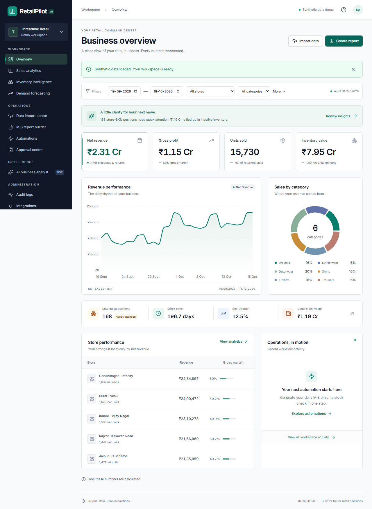
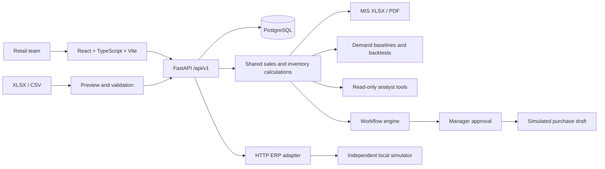

# RetailPilot AI

**Intelligent retail operations & business automation.** A working portfolio application for retail teams that rely on Excel: validate spreadsheets, calculate business performance, plan inventory, review purchasing decisions and export management reports.



This is a fictional, isolated retail demonstration—not a claim of production certification or a commercial ERP connection. The application works without a paid AI API. Data stays on the configured application/database services by default.

[](https://github.com/saifmodan2006/retailpilot-ai/actions/workflows/ci.yml)

## Live portfolio demo

- [Open RetailPilot AI](https://retailpilot-ai.pages.dev/)
- [API health](https://retailpilot-ai-api.onrender.com/api/v1/health)
- [Source and CI](https://github.com/saifmodan2006/retailpilot-ai)

Hosted on Cloudflare Pages Free, Render Free and isolated Neon Free PostgreSQL. Demo startup can take about a minute after inactivity. Access is limited to four fictional workspaces at a time, with two-hour sessions and sample-only uploads. The local ERP simulator is disabled publicly. No paid AI API or paid hosting plan is required. See [executed release checks](docs/verification.md).

## Business problem

Persistent accounts, private organizations and five server-enforced roles are
implemented as a restricted Supabase Auth pilot. Public registration and real
business uploads remain closed. The [account release report](docs/saas-upgrade.md)
documents migrations, permissions, verification scope and remaining live email
checks. Provider mocks establish integration behavior, not delivered production emails.

Retail teams often spend hours reconciling disconnected spreadsheets before they can decide which stores need stock and which purchases deserve approval. RetailPilot turns that workflow into a traceable sequence: inspect data quality, calculate shared KPIs, explain reorder quantities, request a manager decision and export the same figures to MIS. The sample company, products and transactions are fictional. No time-saving percentage or commercial impact is claimed without a real study.

## Working product

- A landing page and 12 connected workspace pages: overview, sales, inventory, forecasting, imports, MIS reports, analyst, workflows, approvals, audit, integrations and settings.
- Real XLSX/CSV ingestion: multi-sheet preview, configurable mappings, required-field and row validation, accepted/rejected counts, error workbooks, persistent history and two layers of duplicate prevention.
- Shared database calculations for revenue, net units, gross profit, margin, stock, cost value, sell-through, stock cover, low stock, dead-stock capital and projected coverage shortfalls. Date/store/category/brand/SKU filters.
- Inventory rules for low stock, excess, slow movement, dead stock, ageing and high demand. Reorder calculations include reservations, confirmed inbound, lead times, safety days, MOQ and supplier pack sizes. Evidence accompanies each recommendation.
- Manager authorization and explicit approval states. Approval creates a **simulated draft** purchase order, never a supplier order or a stock movement. Drafts do not count as confirmed inbound.
- Naive, weekly seasonal naive, 28-day moving average and EWMA forecasts, with three chronological rolling backtests, MAE, WAPE and 7-/30-day horizons. Selected forecast and naive baseline are both visible. No trained-ML superiority claim.
- Nine saved MIS report types with formatted XLSX and PDF exports. Dashboard/report metrics share one calculation service.
- Six deterministic natural-language analytical tools. Optional OpenAI-compatible provider selects an allowlisted tool only; no free-form SQL or autonomous writes.
- Durable workflow state/history, automatic import triggers, manual daily/weekly/stock runs, idempotency keys, bounded retries, cancellation and restart recovery.
- Authenticated, paginated HTTP integration with a separate local ERP simulator. Commercial adapters and external notifications are explicitly unconfigured.
- Alembic schema, PostgreSQL persistence, tenant scoping, expiring JWT demo sessions, request limits, structured logs, Docker services and CI configuration.

## Architecture



Frontend: React 19, TypeScript strict mode, Tailwind 4 plus reusable accessible controls, Recharts, TanStack Query, React Router, React Hook Form and Zod. Backend: Python 3.12, FastAPI, Pydantic 2, SQLAlchemy 2, Alembic, PostgreSQL, Pandas, OpenPyXL, NumPy and ReportLab. The shipped forecaster uses NumPy baselines; the deployment runtime excludes unused scikit-learn and development tools.

## Run with Docker

Prerequisites: Docker Desktop/Engine with Compose, Python 3.12+ to generate local environment values (or manually populate `.env`). Ports 5173, 8000, 8001 and 5433 must be free.

```powershell
git clone https://github.com/saifmodan2006/retailpilot-ai.git
cd retailpilot-ai
py -3.12 scripts/setup-env.py
docker compose up --build -d
docker compose ps
```

Open **http://localhost:5173**. API: **http://localhost:8000/api/v1/health**. Interactive OpenAPI: **http://localhost:8000/docs**. Simulator health: **http://localhost:8001/health**. Compose applies migrations before starting the backend. PostgreSQL uses the named `postgres_data` volume and survives restarts. To stop, run `docker compose down` (without deleting the volume).

## Host development

Prerequisites: Python 3.12+, Node 24, npm, PostgreSQL 17 or Docker. On Linux/macOS use `python3.12` and `.venv/bin/python` in place of Windows commands.

```powershell
py -3.12 -m venv .venv
.\.venv\Scripts\python -m pip install -r backend/requirements.lock.txt
.\.venv\Scripts\python scripts/setup-env.py
docker compose up -d db
cd backend
..\.venv\Scripts\python -m alembic upgrade head
..\.venv\Scripts\python -m uvicorn app.main:app --host 127.0.0.1 --port 8000
```

In another terminal:

```powershell
cd backend
..\.venv\Scripts\python -m uvicorn app.mock_erp:app --host 127.0.0.1 --port 8001
```

In a third terminal:

```powershell
cd frontend
npm ci
npm run dev -- --port 5173
```

Vite proxies `/api` and `/samples` to port 8000. The backend reads the root `.env` regardless of working directory. PostgreSQL host development uses **127.0.0.1:5433**; Docker containers use `db:5432`. For a lightweight fallback set `DATABASE_URL=sqlite:///./retailpilot.db` and apply migrations; PostgreSQL is the recommended demonstration path.

## Environment

See [.env.example](.env.example). `scripts/setup-env.py` creates ignored `.env` secrets and never overwrites an existing file. `DATABASE_URL`, `JWT_SECRET`, `POSTGRES_PASSWORD` configure persistence/session signing; hex passwords avoid URL escaping. Use a stable secret of at least 32 random bytes across workers. `DEMO_ENABLED=true` permits isolated anonymous demo sessions and role simulation. **This is not production account authentication.** With it disabled, demo login/role switching/seeding are blocked; implement OIDC/account provisioning before admitting real organizations.

`ERP_URL`/`ERP_TOKEN` configure only the local simulator. `LLM_ENABLED=false` is the default. Set it true with `LLM_BASE_URL` (including `/v1` where appropriate), `LLM_API_KEY`, and `LLM_MODEL` to explicitly opt into sending the question and tool allowlist to your chosen provider. Uploaded tables are not transmitted. The optional provider path is not live-tested without credentials.

## Demo sequence

1. Start guided demo, then **Load demo data**. Initial generation can take 15-120 seconds depending on the machine and concurrent work; subsequent analytics use persisted records.
2. Inspect the overview and filters. Every figure is labeled synthetic; fixed reporting date is **18 October 2026**.
3. Import `sample_data/sales_import.xlsx`: inspect **15 accepted / 4 rejected**, mappings, source rows and downloadable errors. Import accepted rows; selected-period revenue increases by **INR 55,532.25**.
4. Open Inventory Intelligence → Review a recommendation → inspect formula → Submit for approval.
5. Open Approval Center → Use demo manager → enter reason → Approve draft. A simulated order and audit event appear.
6. Generate a Daily sales MIS; download XLSX/PDF. Ask the analyst “What is our current inventory value?” and inspect the result/period.
7. Open forecasting, workflow history and audit trail. Integrations → Test connection → Preview sales sync; review the batch in Import Center before committing.

The full synthetic dataset is shipped in [sample_data/demo_dataset.zip](sample_data/demo_dataset.zip), with counts in its [manifest](sample_data/manifest.json) and generation code. It contains 12 months, 12 stores, 5 brands, 180 products, 360 variants, suppliers, returns, seasonal fluctuations and deliberate inactive-stock cases. No real business data.

## Tests and builds

```powershell
cd backend
..\.venv\Scripts\python -m pytest tests -q
..\.venv\Scripts\ruff check .
cd ../frontend
npm run lint
npm run build
npx playwright install chromium
# Start backend and frontend first:
npm run test:e2e
```

The backend suite uses known small deterministic fixtures in an isolated temporary SQLite database. Browser journeys run against the actual configured backend and PostgreSQL when following the default setup. Playwright captures real screenshots in `docs/screenshots`; traces and HTML reports are ignored runtime artifacts. See [verification](docs/verification.md) for actual execution evidence and limitations. Remote CI status and deployment evidence are recorded in the verification document.

## Restricted public demo

Public hosting must set `PUBLIC_DEMO=true` on a fresh, dedicated PostgreSQL database. Sessions last two hours; the free-tier configuration admits at most four simultaneous fictional tenants. Expired tenants are removed when a later session is admitted. Server-side quotas bound imports, reports, forecasts, approvals and manual workflows. Only byte-identical supplied XLSX/CSV samples are accepted publicly. Optional LLM providers and private ERP endpoints are rejected at startup. Demo manager switching is allowed only inside explicitly marked fictional organizations. Public OpenAPI pages are disabled. Starting a replacement workspace ends the prior public demo session and makes its fictional data reclaimable on the next admission.

## Deployment and operation

The deployed architecture uses Cloudflare Pages for the React build, Render native Python for FastAPI and Neon PostgreSQL over TLS. The same Docker images can also run on an existing Linux machine or container host. Set `DATABASE_URL` to the managed URL, use TLS per your provider, and keep database/ERP ports private. Serve the frontend behind HTTPS and proxy `/api` to FastAPI. Containers include health checks; `/api/v1/health` checks database connectivity. Run one application worker for this demo's in-process task runner and limiter. Configure backups and retention before storing real data. See [deployment guide](docs/deployment.md).

See [release evidence](docs/verification.md) for verified URLs and test outcomes; unverified hosting is never presented as a live demo. This stack includes a Python server and cannot be deployed as a static-only website.

## Documentation

- [Architecture and security](docs/architecture.md)
- [Business formulas and edge cases](docs/business-logic.md)
- [3–4 minute demo script](docs/demo-script.md)
- [Internship case study and portfolio summary](docs/internship-case-study.md)
- [Verification evidence](docs/verification.md)
- [Recruiter submission checklist](docs/recruiter-submission.md)
- [Working screenshots](docs/screenshots)

## Known boundaries

This is a portfolio demonstrator with real calculations and persistence, not an enterprise deployment. Outstanding production work includes organizational OIDC, shared rate/session controls across multiple instances, scheduled vacuum/storage maintenance, database row-level security, a transactional multi-worker job queue and outbox, inventory cost layers, operational reconciliation and larger-scale SQL aggregation. The task runner supports single-process recovery, not exactly-once distributed execution. No document RAG, commercial ERP, real notifications, committed stock transfers or statistically calibrated confidence intervals are shipped. Supplier planning is adjustable in Settings through the manager-only API. Receipt date approximates ageing; exact FIFO lot ageing is not modeled. Responsive layouts, keyboard focus and targeted automated WCAG checks across all thirteen routes are implemented. Four incomplete automated checks and a full screen-reader/WCAG review remain separate work.

Technical references: [FastAPI security](https://fastapi.tiangolo.com/tutorial/security/oauth2-jwt/) and [SQLAlchemy sessions](https://docs.sqlalchemy.org/en/20/orm/session_basics.html).

MIT licensed. Built as an AI & Business Automation internship portfolio project.
