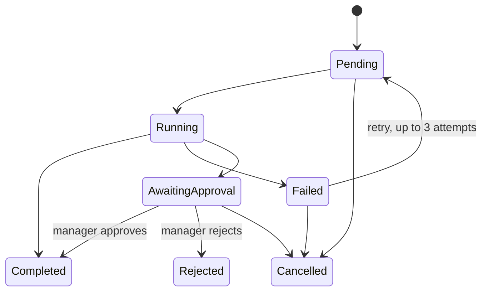

# Architecture

## Data flow

The application is a modular Python monolith. `main.py` owns versioned transport endpoints and validated request bodies; `security.py` supplies tenant/user identity and manager enforcement. `analytics.py`, `imports.py`, `reports.py`, `forecasting.py`, `analyst.py`, `workflows.py` and `integrations.py` hold distinct business responsibilities. React pages call only authenticated analytical/mutation APIs through the shared API client. Recharts uses returned calculations, never a static metrics array.

XLSX/CSV → bounded parser → source payload with sheet/row coordinates → column mapping → row validation → persistent preview/error rows → user commit → sales/snapshot transaction → automatic workflow → saved MIS/recommendations → audit event. All sheets are read; no macros/formulas are executed. A SHA-256 fingerprint includes file bytes plus dataset kind, scoped to tenant. Transaction IDs prevent duplication even when a different file contains the same records. Committing an already imported batch returns an explicit idempotent replay.

Sales and inventory imports have deliberately distinct semantics: sales append unique transaction lines; a same-date store/SKU inventory snapshot replaces that snapshot's quantities. Sales uploads do not decrement stock; the inventory snapshot is the authoritative supplied stock source. This avoids silently double-counting inventory effects from independent ERP extracts.

## Relational design

Every operational row has an organization foreign key, indexed tenant scope and UTC creation timestamp. Organizations own users, stores, brands, categories and suppliers. Products reference brand/category/supplier; SKU variants reference product and carry cost/price/size/color. Sales reference store/SKU and an organization-unique transaction line ID. Inventory snapshots have an organization/store/SKU/date uniqueness constraint. Latest snapshots are selected independently per position.

Import batches own validation errors. Recommendations reference store/SKU and retain the calculation evidence. An approval references one recommendation and requester/reviewer. An approved request produces at most one purchase draft through a unique approval foreign key. Workflow keys are unique per organization. Saved reports retain filters, metrics and rows, so downloads do not drift after subsequent uploads. Forecasts retain version, selection and result JSON. Audit events retain actor/action/reference/evidence. Stock movement and proposed transfer tables are available, but no autonomous movement mutation is exposed.

Alembic's checked-in migration explicitly creates tables/indexes/foreign keys. Startup never calls `create_all` to conceal missing migrations. SQLAlchemy sessions commit successful requests and roll back failures. PostgreSQL is exercised in the browser/integration path; tests use a temporary SQLite database for fast known fixtures. Monetary columns use NUMERIC(14,2); analytical aggregation converts to numeric arrays and rounds displayed/exported totals to two decimals.

## Workflows

Allowed transitions:

Daily/weekly reports and stock checks use FastAPI background tasks after the queue row commits. Results and failure details persist. Restart marks interrupted Running jobs Failed, making them explicitly retryable. Saved work and completion state share the execution transaction. Manual repeated idempotency keys reuse their existing row. Purchase review uses a dedicated authorization/state path and a simulated order only. Run a single backend worker; no distributed task guarantee is claimed.

## Security model

Anonymous demo entry creates a new organization and analyst user, returning an eight-hour signed JWT. Roles are retrieved from the database rather than trusted from UI state. Explicit demo role simulation is gated by DEMO_ENABLED. A caller cannot supply another organization ID to analytics, imports, reports, approvals or the analyst. Record lookup applies both ID and tenant. Requests never accept arbitrary SQL. HTTP bearer tokens are stored locally by the demo frontend; production identity and secure cookie design remain separate work.

Upload bounds are 8 MB compressed, 40 MB expanded XLSX, 500 archive members and 20,000 rows. Parsing errors return structured API errors. Formula-like strings are escaped on Excel export. Parameterized ORM queries protect database values. CORS is allowlisted; errors do not return database internals. Session creation is limited to six per minute per IP, authenticated API calls to 180 per minute per IP within this process. Edge/global limits and durable retention quotas are required for a public service. Secrets are generated into ignored `.env`, never embedded in frontend bundles.

LLM execution is optional and read-only: only the user's question and tool allowlist leave the service after environment opt-in. The returned selector is validated and can only route to existing tenant-scoped functions. Business figures and explanations are composed from trusted service results. It cannot place orders. No outbound email/WhatsApp path is active.

## ERP boundary

`ERPAdapter` defines product/inventory/sales fetches, transaction import and update preview. The local implementation uses bounded pagination, HTTP timeouts, bearer authentication and schema mapping against `mock_erp.py` on a separate port/container and an independent dataset. Sales synchronization creates a review batch; it never bypasses importer validation. Proposed updates remain previews. The simulator's transaction receipt is explicitly nonpersistent; no external commerce is implied.
